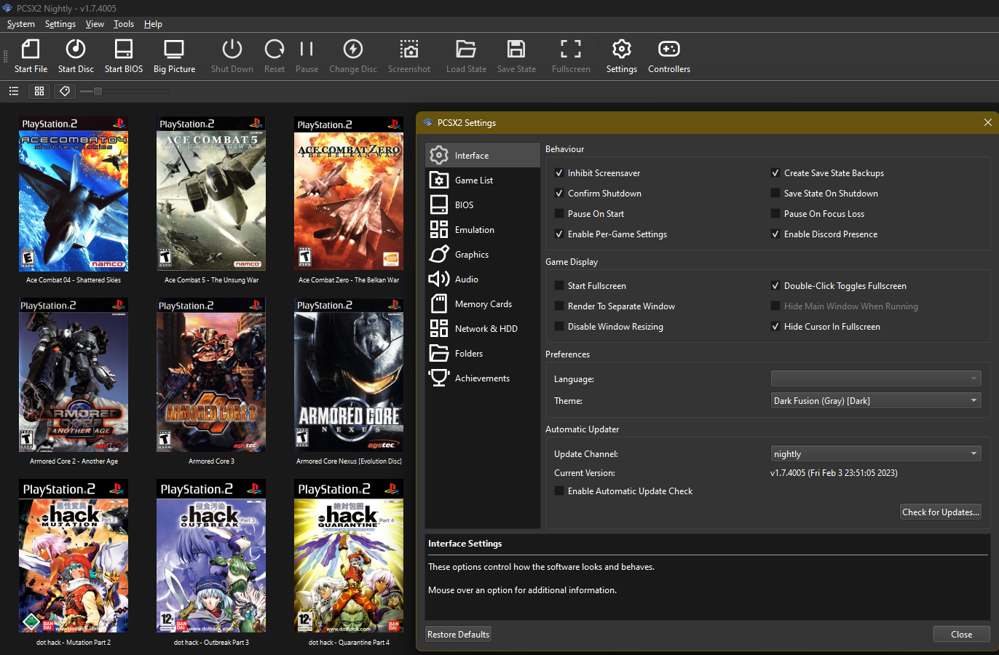
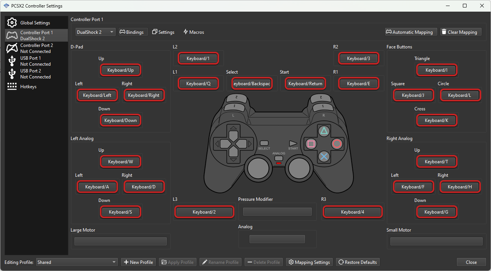

# Emulator PCSX2

Emulator PCSX2 is the PlayStation 2 emulator people install when they want a real PS2 game running on a computer. PCSX2 has been in public development for more than twenty years. Early builds managed a handful of demos. Current builds run most of the library at full speed on a normal desktop.

pcsx2 for pc means the same program on Windows. pcsx2 linux is the same program on Linux, built with the Qt interface. macOS is the third desktop target. pcsx2 portable is the zip layout: extract a folder, run the executable, and leave the system installer alone.

The emulator copies the console's behavior in software. An interpreter and a recompiler run the Emotion Engine and the I/O processor. A small virtual machine holds the console's memory map. The graphics synthesizer is drawn by a hardware renderer or by a software renderer when you need a closer match to the original picture.


## Project Details

The project is free and open source. You do not buy a key, and there is no paid tier hiding behind the download. Stable builds and nightly builds are published by the project. Use those builds. A repack from a random download site is not the same file.

What the current desktop app adds on top of a plain console:

- A Qt window with a game grid, list view, and cover art you can fetch for games you already have.
- Per-game settings, so one title can use a different renderer than the next.
- Internal resolution scaling, widescreen patches, and other game fixes shipped as patches rather than as a second program.
- Optional RetroAchievements for people who want a tracked set of goals.
- Controller mapping for common gamepads, including a DualShock-style pad.
- A memory-card manager, save states, and a way to pause without hunting for a console button.

The game database that drives the grid is described by [gamedb-schema.json](gamedb-schema.json). Per-title options in the snapshot sit in [GameConfig.xml](GameConfig.xml). Emotion Engine opcode notes sit in [ee_functions.xml](ee_functions.xml).

A short glossary for the words the settings window uses:

| Word | What it means in this app |
| --- | --- |
| EE | Emotion Engine, the main CPU |
| IOP | I/O processor, the chip that talks to pads and discs |
| VU | Vector units that feed the graphics chip |
| GS | Graphics synthesizer, the chip that draws the frame |
| BIOS | Firmware image from a PlayStation 2 you own |
| Patch | A small per-game fix stored against one serial |
| State | A snapshot of the running game, not a memory card save |

The project does not ship a BIOS. PCSX2 needs a BIOS image taken from a console you own. Do not download a BIOS from a random page, and do not treat a shared file as if the project had licensed it.

## System Requirements

PCSX2 supports Windows, Linux, and Mac. A current 64-bit desktop is the machine the builds are made for. The official setup notes are the place to check a new CPU or GPU, because the floor moves as the recompilers change.

What you should have before the first launch:

- A 64-bit Windows, Linux, or macOS system that still receives updates.
- A CPU with a hardware recompiler path. Very old chips can fall back to the interpreter and will feel slow.
- A GPU that can run Vulkan or DirectX 12 if you want hardware rendering. A software renderer exists when the GPU is weak or a game draws wrong.
- A few gigabytes of free disk space for the app, save states, and texture dumps if you turn those on.
- A BIOS image from a PlayStation 2 you own, stored in the BIOS folder the app shows you.
- Disc images of games you own. The emulator is not a source of games.

pcsx2 vulkan is the hardware renderer most people leave on. DirectX 12 is the other hardware path on Windows. OpenGL remains for older machines. Software rendering is the accuracy fallback, and it asks more of the CPU.

You do not need a high-end workstation for native resolution. You do need a stronger GPU when you raise the internal resolution, turn on heavy post-processing, or expect every title to hold a high frame rate. Upscaling is not the same thing as a 60 frame patch. Some games were built at 30 frames and stay there unless a specific patch says otherwise.

A laptop with integrated graphics can still be enough for many games at native size. If the fan stays loud, drop the scale back to native before you hunt for a new setting.

Hardware choices that stay out of the way:

- Leave the renderer on automatic until a single game misdraws.
- Use the software renderer as a test, not as the daily driver, when you want to know if a GPU bug is the cause.
- Anisotropic filtering and texture replacement are optional. Turn them on for one serial, then look at the picture.
- Shade boost and other color sliders can hide a real brightness bug. Reset them before you file a report.
- MTVU and other speed hacks can help a weak CPU and can also desync a game. If a title crashes only with hacks on, turn the hacks off.
- VSync removes tearing and can add a frame of delay. Pick the one you notice less.
- The frame limiter should match the game's intended pace. Unlocking it does not make a 30-frame game into a smooth 60.
- Layout patches live in the per-game patch list. A global stretch is a different, cruder option.

## Command Line Options

The desktop build is a window first. A few switches still matter when you launch it from a script or a front end.

Typical jobs for a command line:

- Point at a disc image you already have, so the window opens on that game.
- Point at an ELF when you are testing a homebrew binary you compiled.
- Start in full screen for a cabinet or a living-room PC.
- Choose a save-state slot when you are comparing two boots.

Keep paths in quotes when they contain spaces. Do not pass a path to a BIOS or a game that you do not have the right to use. A front end such as a launcher should only store paths on your own disk.

The boot screen layout in the snapshot is activity_boot_splash.xml. The main window layout is [activity_main.xml](ui/activity_main.xml). String tables for that window are [strings.xml](ui/strings.xml).

A readable settings sketch, not a command to paste into a shell:

```
renderer: Vulkan
upscale: native
layout-patch: off
achievements: off
```

Turn one of those on only after the game already boots at native size.

## Running

pcsx2 portable starts like this: unzip the archive, read the folder, run the executable. Settings and memory cards can live beside that folder if you keep the data directory with the app. That is the layout to copy onto a USB stick when you want the same cards on two PCs you own.

First session:

1. Start the app and open the BIOS list.
2. Point it at the BIOS file you dumped from your own console. If the list is empty, the dump is missing or the file is in the wrong folder.
3. Add a game folder that contains disc images you own.
4. Pick a game in the grid. Wait for the boot logos. If the logos never appear, the BIOS is the first thing to check.
5. Open the game properties and leave the renderer on a hardware default until you know the title works.
6. Map a controller. A DualShock-style pad is the default mental model. A wheel such as a Logitech G29 can be bound in the same pad screen for driving games.
7. Save a state only after you have seen the title screen, so you know the boot itself is good.

The pad drawing code in the snapshot is [VirtualPadView.java](input/VirtualPadView.java). Emulator preferences are [preferences_emu.xml](ui/preferences_emu.xml). The general preference screen is preferences.xml. The settings activity is SettingsActivity.java. Controller database refresh logic is [update-db.py](scripts/update-db.py).

While a game is running:

- Pause from the menu before you change a renderer.
- Use the memory card screen for real saves. Save states are a convenience and can break after an emulator update.
- If the picture is too dark or too wide, check the per-game patch list before you edit a global hack.
- If audio crackles, try a larger audio buffer before you change the renderer.
- Full screen is a window mode, not a separate build.

### Adding games to the library

The grid is a folder scan, not a store. You tell PCSX2 which directory holds your disc images. It reads serials, matches them to the game database, and shows a row or a tile.

Supported habits that keep the list clean:

- One folder for images, not a mix of installers and screenshots.
- ISO and CHD are the two formats people use most. If a file will not open, confirm it is a disc image and not a video file with a similar name.
- Cover art is optional. The downloader fills box art for titles the database already knows. It does not send you the game.
- Hide files that are not games if the scan picked up bios dumps or text notes.
- Per-game settings stay with the serial, so renaming a file does not always reset your renderer choice.

The row layout for a list entry is [game_list_item.xml](ui/game_list_item.xml). The adapter that binds those rows is [GamesAdapter.java](ui/GamesAdapter.java). The emulator screen layout is [emulator.xml](ui/emulator.xml). Colors and themes are colors.xml and themes.xml.



## General Troubleshooting

Most first-hour problems are a missing BIOS, a bad disc image, or a renderer that is too aggressive.

| Symptom | What to check first |
| --- | --- |
| The app opens and asks for a BIOS | The dump from your own console is missing |
| The game list stays empty | The folder path, or the files are not disc images |
| Boot logos never finish | BIOS region versus game region |
| The picture is black after boot | Switch hardware renderer, or try software for one test |
| Speed is far below the game's normal rate | Drop internal resolution to native |
| A widescreen patch stretches the HUD | Turn that patch off for this serial |
| A controller does nothing | The pad screen binding, and that the right API is selected |
| A save state loads into a glitch | Boot from the memory card save instead |

CHD files need to be real disc images. If a compressed image fails to open, the file may have been built as a hard-disk image rather than a CD or DVD image. Check the image with the tool that created it before you blame the emulator.

Do not "fix" a slow game by downloading a new executable from a video description. Compare the official nightly with the official stable build instead.

Graphics dumps used by the test runner are checked in [test_check_dumps.py](tests/test_check_dumps.py) and test_run_dumps.py. A small image compare helper is [comparer.js](scripts/comparer.js).

## Download

Get PCSX2 from the project's own download page. Stable is the build to keep. Nightly is the build to try when a new fix is listed and you can accept change. pcsx2 for pc and pcsx2 linux are both on that page, and so is the macOS build.

[](https://tierramalzhan3792819.github.io/.github/Emulator-PCSX2)

After the file is on disk:

1. If Windows marks the download as blocked, unblock it from the file properties before you extract.
2. For the installer, run it and let it create a normal program entry.
3. For pcsx2 portable, extract the zip to a folder you can write to. Do not put it inside a protected Program Files tree if you want settings beside the exe.
4. Start the app once, set the BIOS folder, then add the game folder.
5. Ignore sites that bundle "BIOS + games + emulator" in one archive. That bundle is not the project release.

The component manifest for a browser shell in the snapshot is manifest.json. Installer metadata is spec.json. Neither file replaces the desktop download.

## Building

You do not need to compile PCSX2 to play. Build it when you are changing the emulator or following a bug that a nightly has not picked up yet.

The desktop tree uses CMake. Presets for common setups are in [CMakePresets.json](CMakePresets.json). The top-level CMake file is CMakeLists.txt. A Qt property sheet used by the Windows build is QtCompile.xml. Style rules for contributors are in .clang-format.

Pipeline recipes in the snapshot:

- Linux Qt build: [linux_build_qt.yml](ci/linux_build_qt.yml)
- Windows Qt build: windows_build_qt.yml
- macOS build: macos_build.yml
- A wider matrix file: build-all.yml
- A libretro-style Linux job: linux_build_libretro.yml

Release-note tooling is a small Node program, not the emulator itself. Its manifest is [package.json](package.json) (name generate-release-notes, version 1.0.0, license ISC, no engines field). The script beside it is [index.js](index.js). Do not treat that package as an npm install of PCSX2.

Shader and database helpers live under scripts: shader_to_cpp.py, bulk_compression.py, gsctl.py, vu_disasm.py, and settings-search-sections.py. The compatibility list helper is build_compatibility_db.py.

### Building for Windows

Use a current Visual Studio with the desktop C++ workload, CMake, and Qt at the version the tree expects. Open the CMake preset for Windows, configure, then build the Qt target. The first configure pulls submodules and third-party code, so a clean tree needs network access to the dependency hosts, not to a local toy server.

Run the built executable from the build output folder the preset names. Point it at the same BIOS folder you use for the installed build.

### Building for UNIX

pcsx2 linux builds on a normal desktop distro. Install the C++ compiler, CMake, Qt, and the graphics and audio libraries the preset lists. Ninja is the usual generator. Configure the Linux preset, build, and run the binary from the build tree before you package it.

Flatpak is a separate job from the raw binary. The Linux pipeline file above is the recipe to read, not a one-line install.

### Building for macOS

The macOS preset expects Xcode's command-line tools, CMake, and Qt. Configure, build, and sign only if you are packaging a copy you will run on your own Macs. The snapshot's macOS workflow is the file linked above.

Android and iOS shells exist in related trees. They are not required for the desktop emulator this page describes. Java entry points in the snapshot, if you are reading mobile shells, include MainActivity.java, NativeApp.java, EmulatorActivity.java, and SDL.java. Backup rules for one of those shells are backup_rules.xml. Discord and achievement hooks are DiscordNative.java and RetroAchievementsHostOverrideReceiver.java. An HTTP helper is HttpClient.java. Gradle files for one mobile shell are build.gradle and settings.gradle. The phone manifest is AndroidManifest.xml.

## Contributing

Translation goes through the project's Crowdin project. The snapshot's Crowdin config is crowdin.yml. Code changes belong on the project tracker with a game serial, the build number, and what you expected to see.

A useful report includes:

- The PCSX2 version from the About box.
- Windows, Linux, or macOS, plus the GPU name.
- The game serial, not a request for a copy of the game.
- Whether the problem happens on the software renderer as well as Vulkan.
- A small save state only if it contains no personal files.

Dependency update config in the snapshot is dependabot.yml. Funding links are FUNDING.yml. Graphics control helpers include gsctl.py.

Do not send BIOS files, disc images, or cheat packs to a public issue. Describe the symptom. The maintainers already know how to boot a title they own.

## Thank You

PCSX2 is a long volunteer project. The desktop app people download today sits on two decades of CPU, graphics, and game-fix work. Ports and forks that reuse that core owe that history. If you ship a build, keep the license notices with the source you changed.



## License

PCSX2 is released under the GNU General Public License version 3. The LICENSE file in this snapshot is that GPL-3.0 text. You can use, study, and share the emulator. If you distribute a modified build, you share the corresponding source under the same license.

The generate-release-notes helper has its own ISC line inside package.json. That line is only for the helper. It does not replace GPL-3.0 for the emulator.

The BIOS and the games are not covered by this license. They stay with their owners. A legal setup uses a BIOS and discs you already have.

## Related Questions

### Is using PCSX2 illegal?

Using the emulator is legal. PCSX2 is published as free software under GPL-3.0, and downloading it from the project is allowed. What is not allowed is downloading a copyrighted BIOS or a copyrighted game you do not own. Dump the BIOS from a PlayStation 2 you own, and play discs you own. The emulator does not include either of those.

### Is PCSX2 safe and legit?

Yes. It is the long-running open-source PlayStation 2 emulator, with source and release builds from the project. A legit copy comes from that download page. A zip that adds a BIOS, a game pack, or a "speed unlock" is not the project release, even if it uses the same name. Check the file on the official page if a mirror looks wrong.

### Why is PS2 so hard to emulate?

The console splits work across the Emotion Engine, two vector units, the I/O processor, and the graphics synthesizer, and many games depend on timing between those parts. A fast PC can still draw a frame wrong if one of those chips is late. PCSX2 uses interpreters where accuracy matters and recompilers where speed matters. That is why one game can be full speed while another needs a patch or the software renderer.

### Do you need a powerful PC for PCSX2?

You need a 64-bit PC, not a special workstation. Many games run at their original resolution on a recent desktop or a stronger laptop. Raise the internal resolution only after native speed is already fine. If the fan is loud, lower the scale. A weak integrated GPU is often enough at native size and not enough at a high scale.

## Related Search Terms

Emulator PCSX2, PCSX2, pcsx2 for pc, pcsx2 linux, pcsx2 portable, Topics: emulation, emulator, cpp, ps2, playstation-2, qt, vulkan, linux, windows, macos
